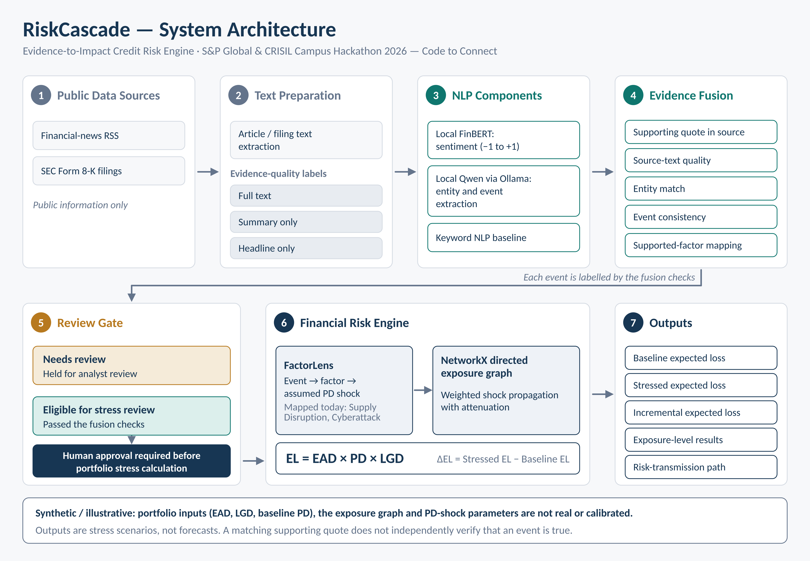

# RiskCascade — Evidence-to-Impact Credit Risk Engine

**S&P Global & CRISIL Campus Hackathon 2026 — Code to Connect**

**Candidate Name:** Akanksha Gangrade  
**College Email ID:** 2311201260@stu.manit.ac.in  
**College / Campus:** Maulana Azad National Institute of Technology  
**Project Type:** Individual submission  
**Interface:** Streamlit  
**Demo Video:   
**Presentation Deck:** `docs/presentation.pdf`
**RiskCascade architecture: ** `docs/architecture.png`

---

## 1. Project Overview / Problem Statement & Approach

Financial risk information often appears first in unstructured sources such as financial news and corporate disclosures. Extracting a meaningful event from text is only the first step: understanding its potential financial implications also requires identifying the affected entity, translating the event into an assumed risk-factor shock, and tracing the shock through connected exposures.

**RiskCascade — Evidence-to-Impact Credit Risk Engine** is a prototype that demonstrates this information-to-impact workflow. It combines public-source ingestion, financial sentiment analysis, local language-model-based event extraction, evidence checks, event-to-factor mapping, exposure-graph propagation, and illustrative portfolio expected-loss calculations in a Streamlit dashboard.

The prototype separates text analysis from financial modelling. An event is not automatically treated as a financial loss: the result depends on the event attributes, evidence quality, configured shock assumptions, graph dependencies, and exposure parameters. The system compares baseline and stressed expected loss to illustrate how a risk event may affect connected portfolio exposures.

**Important:** The financial shocks, portfolio exposures, and cached demonstration scenarios are synthetic or illustrative. The resulting expected-loss values are not calibrated forecasts, validated credit-risk predictions, or investment advice.

## 2. Architecture & Tech Stack

### Architecture

The prototype follows this flow:

1. **Public information ingestion:** Retrieves financial-news RSS entries and SEC Form 8-K filing information.
2. **Text and evidence preparation:** Attempts to retrieve source text and labels evidence quality, such as full text, summary only, or headline only.
3. **NLP analysis:** Uses FinBERT for financial sentiment, a locally hosted Qwen model through Ollama for event extraction, and a keyword-based NLP baseline.
4. **Evidence fusion:** Checks supporting-quote presence, source-text quality, company matching, event consistency, and event-to-factor mapping.
5. **FactorLens:** Maps supported risk-event types to explicitly configured, illustrative probability-of-default (PD) shocks.
6. **Exposure propagation:** Uses a directed NetworkX graph to propagate shocks through connected entities using configured edge weights and attenuation.
7. **Expected-loss calculation:** Compares baseline and stressed expected loss at exposure level.
8. **Dashboard:** Presents the analysis, exposure paths, financial metrics, and synthetic demonstration scenarios in Streamlit.

### Architecture diagram

The architecture diagram will be published at `docs/architecture.png`.



### Technology stack

| Component | Technology |
|---|---|
| Programming language | Python |
| User interface | Streamlit |
| Data handling | pandas |
| Exposure graph | NetworkX |
| Visualisation | Plotly |
| Financial sentiment | FinBERT (`ProsusAI/finbert`) |
| Local language model | Qwen through Ollama |
| Public-source ingestion | RSS, HTTP requests, SEC filing pages |
| Text extraction | trafilatura and Beautiful Soup |
| Testing | pytest |

### Expected-loss calculation

The prototype uses the standard expected-loss relationship:

**Expected Loss = EAD × PD × LGD**

Where:

- **EAD:** Exposure at Default.
- **PD:** Probability of Default.
- **LGD:** Loss Given Default.

The engine compares baseline expected loss with stressed expected loss after applying its configured event shock and graph-propagation assumptions.

The shock parameters in this prototype are illustrative and have not been statistically calibrated against historical credit outcomes.

## 3. Dataset Used

The prototype combines public-source ingestion with synthetic demonstration data.

### Public sources

**Financial news**

The ingestion module retrieves news entries from RSS feeds, including Google News RSS queries covering financial news and supply-chain/cyber-risk topics. Article text availability depends on the publisher and source accessibility; some results may contain only a headline or summary.

**SEC filings**

The ingestion module retrieves public SEC current Form 8-K filing information and attempts to extract relevant filing and exhibit text.

Sources:

- Google News: https://news.google.com/
- SEC EDGAR: https://www.sec.gov/edgar/search/

The live-source workflow depends on network connectivity and source availability. Retrieval of full text is not guaranteed.

### Synthetic demonstration data

The `data/` directory contains the data required for the deterministic demonstration:

- `data/cached_events.json` — synthetic risk-event scenarios.
- `data/exposure_graph.json` — synthetic entities, dependency edges, and exposure parameters.

The current synthetic examples include:

**Scenario A — Global SemiCorp: Supply Disruption**

A synthetic factory-fire scenario is propagated through an illustrative dependency path:

Global SemiCorp → Tier-1 Auto Controls → MegaMotors → Facility A.

**Scenario B — Apex Parts: Cyberattack**

A synthetic cyberattack scenario is propagated through an illustrative dependency path:

Apex Parts → Auto Systems Integrator → Facility B.

The companies, events, portfolio relationships, exposure values, and associated financial outputs in these examples are illustrative. They do not represent verified real-world events, actual customer portfolios, or confidential client information.

### Data assumptions and limitations

- Full article text may not be available for every news result.
- Source-text quotation matching checks whether extracted evidence appears in available text; it does not independently establish that an event is true.
- Company-name matching and event classification can produce errors.
- PD shocks, graph weights, attenuation, EAD, LGD, and baseline PD values are prototype assumptions.
- The synthetic scenarios demonstrate calculation and propagation logic, not predictive accuracy.
- No proprietary S&P Global or CRISIL client data is used.

## 4. Quickstart & Installation

### Requirements

- Python 3.12 or a compatible Python version supported by the installed dependencies.
- Git.
- Internet access for installing dependencies and retrieving live public-source data.
- Ollama and the configured Qwen model for the local LLM workflow.

The synthetic demo is intended to be the primary demonstration path. Live LLM analysis requires Ollama to be running locally.

### Clone the repository

```bash
git clone <YOUR_PUBLIC_GITHUB_REPOSITORY_URL>
cd <YOUR_REPOSITORY_FOLDER>
```

### Create a virtual environment

**Windows PowerShell:**

```powershell
python -m venv venv
.\venv\Scripts\Activate.ps1
python -m pip install --upgrade pip
pip install -r requirements.txt
```

If PowerShell blocks environment activation, use Command Prompt and run:

```bat
venv\Scripts\activate.bat
```

### Run the dashboard

```powershell
streamlit run app.py
```

Streamlit will display a local URL, usually `http://localhost:8501`. Open that URL in your browser.

### Run the synthetic demonstration

1. Open the **Synthetic Demo** tab.
2. Select the Global SemiCorp supply-disruption scenario.
3. Run the scenario and inspect the exposure-propagation graph.
4. Review baseline expected loss, stressed expected loss, and incremental expected loss.
5. Repeat with the Apex Parts cyberattack scenario.

These cached scenarios are the recommended presentation path because they do not require successful live-news retrieval for the core financial demonstration.

### Enable local LLM analysis

Install Ollama from https://ollama.com/ if it is not already installed.

Pull the configured model:

```powershell
ollama pull qwen3:8b
```

Ensure the Ollama API is reachable at `http://localhost:11434`. If Ollama is not already running as a background service, start it in a separate terminal:

```powershell
ollama serve
```

Keep the Ollama service running while using local LLM analysis. The model may require substantial memory and can run more slowly on some machines.

### Run tests

```powershell
python -m pytest -q
```

The project previously passed 12 automated tests. Run the command against the submitted version and report the current result rather than assuming the previous result still applies.

## 5. Key Results & Domain Impact

### Demonstrated capabilities

The prototype demonstrates:

- Ingestion of public news and SEC filing information.
- Financial sentiment analysis and structured event extraction.
- Evidence-quality checks and entity/event consistency checks.
- Explicit event-to-risk-factor mapping.
- Directed graph-based propagation of illustrative risk shocks.
- Exposure-level expected-loss calculations.
- A Streamlit interface for inspecting risk scenarios and their financial implications.

### Synthetic scenario results

The following are previously observed demonstration outputs. Reproduce the scenarios using the submitted version before treating these figures as final.

| Scenario | Baseline expected loss | Stressed expected loss | Incremental expected loss |
|---|---:|---:|---:|
| Global SemiCorp — Supply Disruption | ₹4,05,000 | ₹4,49,055.90 | ₹44,055.90 |
| Apex Parts — Cyberattack | ₹4,05,000 | ₹4,31,604.70 | ₹26,604.70 |

**These values are illustrative outputs from synthetic portfolio assumptions. They are not real losses, forecasts, measured business savings, or evidence of predictive accuracy.**

### Domain impact

RiskCascade demonstrates a potential workflow for helping analysts move from unstructured public information to a structured and inspectable financial-risk scenario.

Its main contribution is the explicit separation of:

- Text extraction and sentiment.
- Evidence checks.
- Event-to-factor mapping.
- Exposure propagation.
- Expected-loss calculation.

This makes the assumptions and intermediate steps easier to inspect than a system that produces only a sentiment score or an unexplained risk number.

### Potential business relevance

The concept could be explored for credit-risk monitoring, counterparty-risk analysis, supplier-risk monitoring, and portfolio scenario analysis.

This is a potential application, not an existing commercial product, customer deployment, partnership, or endorsement by S&P Global or CRISIL.

## 6. Limitations & Future Work

The current version is a prototype and has several limitations:

1. **Source coverage:** Public-source retrieval and full-text extraction are not guaranteed for every article.
2. **NLP reliability:** Language models and keyword heuristics can misclassify events, entities, or supporting evidence.
3. **Evidence verification:** A quotation matching source text does not prove that the reported event is factually correct.
4. **Shock calibration:** Event-to-PD shock magnitudes are illustrative, not statistically calibrated.
5. **Exposure data:** The demonstration graph and portfolio inputs are synthetic.
6. **Validation:** Historical backtesting, calibration studies, and benchmark comparisons are needed before real-world risk decisions.
7. **Production readiness:** Enterprise security, monitoring, governance, data integration, and operational reliability have not been established.

Potential next steps include broader event coverage, improved source corroboration, historical validation, calibrated financial mappings, and integration with verified portfolio data.

## 7. Demo & Presentation

- **Demo video:** [Add the YouTube Unlisted URL]
- **Presentation PDF:** `docs/presentation.pdf`
- **Architecture diagram:** `docs/architecture.png`

The demo video will show the application setup, the synthetic scenarios, exposure propagation, expected-loss calculations, and the limitations of the current prototype.

Before submission, verify that the video is accessible through its Unlisted link and that the presentation PDF and architecture diagram exist in the public repository.

---

**Disclaimer:** RiskCascade is an educational hackathon prototype. Its synthetic scenarios, event mappings, portfolio parameters, and financial outputs are illustrative and should not be used for actual lending, investment, or credit-risk decisions.